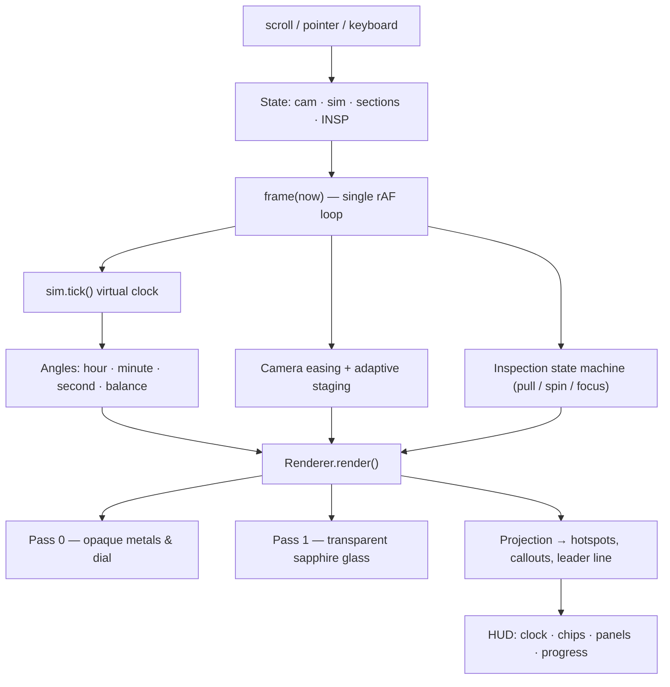

# CHRONOS ONE

> **Haute horlogerie, rendered live in the browser.**
> An architectural luxury timepiece concept with a real-time 3D calibre — built from raw WebGL2, with **zero frameworks, zero dependencies and zero build step**.

**▶ Live demo: https://hsassouma.github.io/CHRONOS/** &nbsp;·&nbsp; **Repository: https://github.com/HSassouma/CHRONOS**

`CHRONOS ONE` is a single-page immersive product experience: a scroll-driven story in five chapters where the visitor steers a *simulated* mechanical movement, orbits the watch, explodes the assembly into nine hand-finished components, and pulls individual parts out of the case to inspect them — all in real time, on a custom-written rendering pipeline.

---

## Table of contents

- [Overview](#overview)
- [Highlights](#highlights)
- [Tech stack](#tech-stack)
- [Project structure](#project-structure)
- [Architecture](#architecture)
  - [1. Time simulation](#1-time-simulation)
  - [2. Procedural geometry](#2-procedural-geometry)
  - [3. Custom WebGL2 renderer](#3-custom-webgl2-renderer)
  - [4. Interaction layer](#4-interaction-layer)
  - [5. Adaptive staging (layout ↔ 3D)](#5-adaptive-staging-layout--3d)
- [Getting started](#getting-started)
- [Commands](#commands)
- [Testing & QA](#testing--qa)
- [Performance](#performance)
- [Accessibility](#accessibility)
- [Graceful degradation](#graceful-degradation)
- [Design system](#design-system)
- [Debug API](#debug-api-windowchronos)
- [Project stats](#project-stats)
- [Known gaps](#known-gaps)
- [Disclaimer](#disclaimer)

---

## Overview

| | |
|---|---|
| **Product** | Luxury watch concept landing experience (scroll-driven, 5 chapters) |
| **3D** | Procedurally modelled, rendered by an in-house WebGL2 / GLSL ES 3.0 pipeline |
| **Libraries** | None. No Three.js, no GSAP, no jQuery, no CDN, no `node_modules` |
| **Build** | None — plain ES modules served statically |
| **Runtime** | Modern browsers only (WebGL2 is a hard requirement for the 3D; an SVG fallback covers the rest) |
| **Languages** | Vanilla JavaScript (ES2022 modules), HTML5, CSS3, GLSL ES 3.00, Python (tests), Node.js (server + checks) |

### The five chapters

| # | Section id | What happens |
|---|---|---|
| — | `#reveal` | Intro curtain, hero headline, key specs ticker, cinematic camera preset |
| 01 | `#time` | **Simulated time** — pause, reverse, slow (¼×), fast (8×), scrub ±120 min, resync to live |
| 02 | `#inside` | **Anatomy** — orbit the watch, 5 projected hotspots, click parts for details |
| 03 | `#explode` | **Exploded view** — slider separates the 9-part assembly, per-part callout chips |
| 04 | `#craft` | **Specification** — full technical sheet + hand-drawn SVG blueprint of the 41 mm case |

---

## Highlights

- **Custom WebGL2 renderer** — one vertex + one fragment shader implementing a PBR-style model: Cook-Torrance GGX specular, physical Fresnel (metal / dielectric F0), a *procedural studio environment map* (key softbox, champagne fill, violet kicker, cyan bounce, horizon line), split-sum IBL approximation, anisotropic radial sunburst on the dial, rim silhouette lighting, cavity AO, ACES filmic tone mapping and gamma correction — plus a dedicated alpha pass for the AR-coated sapphire crystal.
- **9 fully procedural components** — crystal, bezel, hands, dial, movement, case, bracelet, case back, crown — assembled from revolve/extrude/chamfer primitives (22,892 triangles total), no `.glb`, no `.obj`, no external assets.
- **Virtual clock (`TimeSim`)** — the real system clock is never mutated; only a virtual `t` is integrated with a rate multiplier, so reversing time or scrubbing is always safe and reversible.
- **Exploded view** — global separation slider + per-section auto-explode, with screen-space projected callout pills.
- **Component surgery** — CPU ray-cast picking against live geometry, drag a part out along its constrained axis, <kbd>⇧</kbd>-drag to spin it, camera focus on the extracted part, leader line back to its seat, `Esc` to return. Manual poses are layered *at render time*, so a returned part is bit-exact — no drift after repeated cycles.
- **Adaptive staging** — the renderer measures the watch's on-screen bounding box every frame and eases camera distance/lateral offset so the 3D never collides with the reading panel (side-by-side layout on desktop, bottom-sheet band on mobile).
- **Graceful degradation** — no WebGL → `.no-gl` mode with an animated 2D SVG face, honest disabled exploded view, and fully working time controls.
- **Zero console errors, zero failed requests** on load (verified by the E2E suite).
- **Self-hosted fonts** — 5 `woff2` files with `<link rel="preload">`; no font CDN, no layout shift.

---

## Tech stack

| Layer | Technology | Where |
|---|---|---|
| Markup | Semantic HTML5 (landmarks, `aria-*`, `role=timer`, skip link) | `index.html` |
| Styling | Modern CSS — custom properties (design tokens), `clamp()` fluid type, grid/flex, `@supports`, `@media print`, `prefers-reduced-motion` | `css/style.css` |
| Application logic | Vanilla ES modules, `requestAnimationFrame` loop, event-driven | `js/main.js`, `js/time.js` |
| 3D / graphics | **WebGL2** + **GLSL ES 3.00** (hand-written shaders), custom `mat4` math with object pooling | `js/main.js` |
| Local server | Node.js built-in `http`/`fs`/`path` static server (GET/HEAD only, path-traversal guarded, port fallback) | `server.js` |
| Static checks | Node.js script (dependency-free DOM/asset lint) | `node_checks.js` |
| End-to-end tests | **Playwright for Python** + **Pillow** (screenshot variance checks) → generates `TEST_REPORT.md` | `run.py` |
| Unit tests | `node --test` (Node's built-in test runner) | *see [Known gaps](#known-gaps)* |

> **No package manager is required to run the site.** `npm`/`pip` are only needed for the optional test tooling.

---

## Project structure

```text
CHRONOS/
│
├── index.html              # Single document: 5 chapters, SVG watch face, blueprint, HUD
├── css/
│   └── style.css           # Design tokens, layout, responsive, reduced-motion, print
│
├── js/
│   ├── main.js             # Everything: math → geometry → shaders → renderer → UI wiring
│   └── time.js             # TimeSim: the virtual clock (14 lines, fully unit-testable)
│
├── fonts/                  # Self-hosted variable-weight woff2 (no CDN)
│   ├── cormorant-garamond-latin.woff2          # Display / editorial serif
│   ├── cormorant-garamond-latin-italic.woff2
│   ├── space-grotesk-latin.woff2               # UI / body sans
│   ├── space-mono-latin-400.woff2              # Data / clock mono
│   └── space-mono-latin-700.woff2
│
├── server.js               # Dev static server (node server.js → :8732)
├── node_checks.js          # Dependency-free static checks (22 assertions)
└── run.py                  # Playwright E2E suite → TEST_REPORT.md
```

### Inside `js/main.js` (the engine)

`main.js` is organised as a strict pipeline — each block only depends on the ones above it:

```text
1.  Imports & state          TimeSim instance, camera presets, reduced-motion flag
2.  Matrix mathematics        column-major mat4 on Float32Array(16) + object pool (MAT_POOL)
3.  Geometry primitives       lathe · extrude · beveledBox · merge · shift · bake · gearPoly
4.  Model builders            sculptedLug · buildBracelet · appliedIndices · dauphineHand
                              dateDigitGeo (7-segment) · moonphaseGeo · openHeartFrameGeo
5.  Scene assembly            9 parts × N meshes, material palette in linear colour space
6.  Shaders                   GLSL ES 3.00 VS/FS, studioEnv() + acesFilmic()
7.  initGL()                  program/VAO setup, two-pass render(), project() helper
8.  Page wiring               sections, nav marking, panel fades, controls, hotspots
9.  Component surgery         pickPart()/triHit() ray-casting, pull/spin/inspect state machine
10. Chrome UI                 progress hairline, callout chips, hint, contact shadow
11. Adaptive staging          measure → ease camera distance & lateral shift
12. frame()                   the single rAF loop that drives everything
13. window.CHRONOS            debug/testing API
```

---

## Architecture



### 1. Time simulation

`js/time.js` is deliberately tiny and pure:

```js
tick()  // live  → t = Date.now()   (follows the real clock)
        // else  → t += dt * rate   (rate: -4 | 0 | 0.25 | 1 | 8)
```

- `goLive()` / `offset(min)` / `setRate(r)` are the only three ways to change time, and every one of them is idempotent.
- UI labels derive from state (`Live time`, `Simulated: Paused`, `Reverse 4×`, `Fast 8×`), so the page **never lies about which clock is driving the hands**.
- Reduced-motion mode snaps the seconds hand to whole seconds instead of sweeping.

### 2. Procedural geometry

Everything is generated at boot from math — there are no model files to download:

| Builder | Produces |
|---|---|
| `lathe(profile, segments)` | Revolution surfaces with hard or smoothed normals (case, bezel, crystal, barrel) |
| `extrude(polygon, h)` | Prism sweeps with correct side normals (hands, indices, gaskets) |
| `beveledBox(w,h,d)` | Chamfered boxes for bracelet links (45° polished anglage) |
| `sculptedLug(x, z)` | Curved horn lugs |
| `buildBracelet(top)` | The full articulated multi-link bracelet + clasp |
| `gearPoly(n, ro, ri)` | Parametric gear silhouettes for the train |
| `dateDigitGeo`, `moonphaseGeo`, `openHeartFrameGeo` | The three complications (date at 3, moonphase at 6, open heart at 8) |

Meshes are merged (`merge`), moved (`shift`) and baked (`bake`) into part space once at load, then uploaded as static VBOs + `Uint32` indices into a VAO per material.

### 3. Custom WebGL2 renderer

- **One program.** All material variation travels in uniforms (`uC` base colour, `uK` metal/rough/alpha, `uI` iridescence/brush, `uS` sunburst flag, `uHl` interaction highlight).
- **Two passes per frame**: opaque (depth write on) → transparent sapphire (blend + `depthMask(false)`), so the crystal refracts the dial beneath without sorting artefacts.
- **Lighting**: 4-light procedural studio environment evaluated analytically in the fragment shader (`studioEnv()`), plus direct key/fill GGX highlights and Fresnel-weighted rim lights.
- **Tone**: Narkowicz ACES filmic curve → linear-to-sRGB (`pow(1/2.2)`).
- **Transparency contract**: `webglcontextlost` is handled — it immediately drops to the SVG fallback instead of freezing.
- **Camera**: hand-written perspective + look-at, with an off-centre projection term (`P[8]`, `P[9]`) used to shift the watch away from the text panel without moving the model.

### 4. Interaction layer

| Gesture / key | Action |
|---|---|
| Drag on canvas | Orbit (`ua`, `ue`) |
| <kbd>+</kbd> / <kbd>−</kbd> | Zoom (`uz`) |
| <kbd>0</kbd> | Reset view |
| <kbd>←</kbd><kbd>→</kbd><kbd>↑</kbd><kbd>↓</kbd> | Rotate (keyboard parity with the mouse) |
| Click a part | Select + info panel (`Remove`, `Inspect closer`, `Reassemble`) |
| Drag a selected part | Extract along its constrained axis |
| <kbd>⇧</kbd> + drag | Spin the part about its own axis |
| <kbd>Esc</kbd> | Return the part to its seat |
| Slider `#ex` / `Reassemble` | Global explode state (reconciles any manual extraction first) |

Picking is done on the CPU with a ray/triangle test (`pickPart` → `triHit`) against the *live* transforms, so picking stays correct while parts are exploded or pulled.

### 5. Adaptive staging (layout ↔ 3D)

Each frame the renderer projects an envelope of the watch's widest points, computes its on-screen box, and eases:

- **desktop/side-by-side** → camera distance + lateral shift so the watch fits the free band beside the reading card;
- **mobile bottom-sheet** → vertical recentring so the watch always stays above the card.

Panel rectangles, section tops and callout sizes are cached and re-measured only on `resize`, `scroll` and `document.fonts.ready`.

---

## Getting started

**Requirements:** Node.js ≥ 16 (for the dev server and checks). Nothing else to run the site.

```bash
# 1. clone / open the folder
cd CHRONOS

# 2. serve it (any static server works)
node server.js
#   → CHRONOS static server listening on http://localhost:8732
#   → falls back to :8733 automatically if the port is taken
```

Alternatives:

```bash
python -m http.server 8732     # Python built-in
npx serve .                    # or any static host — no build, no config
```

Then open **http://localhost:8732** — the 3D scene needs a browser with WebGL2 (all current Chrome / Edge / Firefox / Safari).

### Deployment

The project is a plain static bundle — no build output to publish. It is deployed on
**GitHub Pages** from the `main` branch, root `/` (the `.nojekyll` file makes Pages serve every
asset verbatim, without a Jekyll pass):

- **Live site:** https://hsassouma.github.io/CHRONOS/
- **Repository:** https://github.com/HSassouma/CHRONOS

Any other static host (Netlify, Vercel, S3 + CloudFront, nginx) works exactly the same way:
publish the folder as-is.

---

## Commands

| Command | What it does |
|---|---|
| `node server.js` | Dependency-free static server with path-traversal protection, `GET`/`HEAD`-only, MIME map, port fallback |
| `node node_checks.js` | 22 static assertions: assets, fonts, `@font-face`, module scripts, duplicate ids, in-page anchors, section ids, hotspots, controls, reduced-motion & keyboard hooks. Exit code `0` on success |
| `python run.py` | Full Playwright E2E suite (see below) → writes `TEST_REPORT.md` |
| `node --test test/time.test.mjs` | Unit tests for the time simulation *(file not yet written — see [Known gaps](#known-gaps))* |

---

## Testing & QA

`run.py` boots a local server, drives Chromium through the whole experience and writes a Markdown report.

```bash
pip install playwright pillow
playwright install chromium
python run.py          # → TEST_REPORT.md
```

**What it covers**

| Area | Checks |
|---|---|
| Load | No JS/console errors, no failed requests |
| 3D | WebGL2 active, 9 parts present, canvas is *not blank* (screenshot pixel std-dev > 8) |
| Time | Pause / Reverse (−4×) / Fast (8×) / Slow (¼×) rates within tolerance, scrub offset, resync to live, label wording |
| Camera | Mouse orbit, keyboard rotate + zoom, `0` reset, on-screen buttons |
| Hotspots | All 5 visible in the Anatomy chapter, content on click |
| Exploded | Auto-separate, slider close/open, `Reassemble` returns to 0 |
| Keyboard | Visible ≥ 2 px focus ring on the first 12 tab stops |
| Links / a11y | Every in-page anchor resolves; every `button`/`a`/`input` has an accessible name |
| Reduced motion | No intro animation, stepped seconds, transitions disabled |
| No-WebGL | `.no-gl` class, SVG face visible, canvas hidden, no errors, time controls still work |
| Responsive | No horizontal overflow at 390 / 820 / 1440 px; ≥ 44 px touch targets on mobile |
| Perf | Frame rate sampled (reported as **INFO** — headless Chromium runs software WebGL/SwiftShader, so the number is not representative of real hardware) |

`node node_checks.js` covers the static side (markup/asset wiring) and currently reports **22 / 22 PASS**.

---

## Performance

- **Zero network weight beyond the page itself** — no frameworks, no CDN, no model downloads; fonts are the only extra assets.
- `Float32Array` matrix **object pool** (`MAT_POOL`) — no per-frame allocation in the hot path.
- **Device-pixel-ratio capped at 2** to keep fill-rate sane on high-DPI screens.
- Static layers (film grain, starfield, gradients) are single, never-repainted CSS layers; the scroll progress hairline is a pure `scaleX` transform.
- Clock/explode DOM updates **throttled to 10 Hz**; scroll handler is `passive` and only marks work dirty — all measurement happens once per frame.
- `requestAnimationFrame` loop **returns early when `document.hidden`** (no background battery drain).
- Panel/section rectangles, callout sizes and stage boxes are cached and re-measured only on real layout changes.

---

## Accessibility

- Skip link, semantic `<header>/<main>/<footer>`, labelled `<nav>` landmarks.
- `aria-pressed` on every toggle, `aria-live="polite"` on changing status text, `role="timer"` on the clock, descriptive `aria-label` on the canvas (*"Arrow keys rotate, plus and minus zoom, zero resets the view"*).
- **Full keyboard parity** with the mouse for the 3D scene; focus rings are ≥ 2 px and verified automatically.
- 44 px minimum touch targets on mobile; contrast-safe ink tokens on dark surfaces.
- `prefers-reduced-motion: reduce` honoured in **both** CSS and JS (no curtain intro, no panel transitions, stepped seconds).
- Every control has a visible text or `aria-label` name (asserted by the test suite).

---

## Graceful degradation

| Condition | Behaviour |
|---|---|
| No WebGL2 / context lost | `.no-gl` mode: animated **2D SVG watch face**, canvas hidden, exploded slider disabled *with an honest explanatory note*, all time controls still functional |
| Reduced motion | Instant state changes, discrete seconds, no parallax |
| No JavaScript | The intro curtain never renders (it only exists under `.js`), so a script failure can never trap the page — content and the SVG face stay readable |
| Narrow viewport | Panels become bottom sheets; staging fits the watch into the band above |
| Print | Dedicated `@media print` styles strip the chrome and print the specification sheet |

---

## Design system

All visual decisions live as **CSS custom properties** in `:root` — nothing is hard-coded in components.

| Token group | Examples |
|---|---|
| Cosmic palette | `--deep-space #020409`, `--midnight-blue #07091A`, `--cosmic-violet #6C5CE7`, `--ice-silver #DDE3F0` |
| Material colours | `--steel`, `--bronze`, `--bone`, `--anth` (also mirrored by the SVG fallback face) |
| Ink / surfaces | `--ink-bright` → `--ink-faint`, `--surface`, `--hairline`, `--surface-solid` |
| Gradients | `--bg-grad` (radial nebula), `--chrome-grad` (metal), `--panel-grad` |
| Type scale | `--text-xs … --text-hero` — all `clamp()` fluid values |
| Spacing scale | `--space-1 … --space-10` — fluid |
| Motion | `--ease-out`, `--ease-spring`, `--duration-fast/normal/slow/entrance` |
| Effects | `--shadow-sm/md/lg`, `--glow-violet`, `--glow-bronze`, `--shx` (JS-driven contact shadow) |

**Typography** — three self-hosted families:
*Cormorant Garamond* (editorial display serif) · *Space Grotesk* (interface sans) · *Space Mono* (clock, specs, blueprint annotations).

---

## Debug API (`window.CHRONOS`)

Exposing runtime state makes the page testable from the console or Playwright:

```js
CHRONOS.gl          // boolean — is WebGL2 active?
CHRONOS.tris        // total triangle count (22,892)
CHRONOS.parts       // ['crystal','bezel','hands','dial','movement','case','strap','caseback','crown']
CHRONOS.cam         // { a, e, d, sx, ua, ue, uz, E, ... } camera + explode state
CHRONOS.sim         // { t, rate, live } virtual clock
CHRONOS.A           // { h, m, s, bal } current hand/balance angles
CHRONOS.RM          // reduced-motion preference

CHRONOS.insp.select('dial')     // select a component
CHRONOS.insp.extract('crown')   // pull it out
CHRONOS.insp.state('crown')     // inspect pose numerics
CHRONOS.insp.pick(x, y)         // screen → part hit-test
CHRONOS.insp.proj(x, y, z)      // world → screen projection
CHRONOS.insp.reassemble()       // put everything back
```

---

## Project stats

| Metric | Value |
|---|---|
| Source files | 7 (`index.html`, `style.css`, `main.js`, `time.js`, `server.js`, `node_checks.js`, `run.py`) |
| Lines of code | ≈ 3,770 |
| Dependencies (runtime) | **0** |
| Build steps | **0** |
| 3D parts | 9 |
| Triangles | 22,892 |
| Shaders | 1 program (VS + FS, GLSL ES 3.00) |
| Fonts | 5 self-hosted `woff2` |
| Static checks | 22 / 22 passing |
| Console errors on load | 0 |

---

## Known gaps

- `run.py` invokes `node --test test/time.test.mjs`, but that unit-test file **does not exist yet** — the E2E report will mark that row as failed until it is written. (`js/time.js` was intentionally kept pure and dependency-free so it can be tested with Node's built-in runner with no setup.)
- Lighthouse, axe-core, W3C HTML validation and screen-reader passes are listed as `NOT RUN` in the generated report — the tools are not installed in the current environment.
- WebGL context-loss recovery has a handler but is not exercised by the suite.

---

## Disclaimer

> CHRONOS ONE is a **fictional concept study**. It is an original artistic piece, not a commercial product, and is not for sale. All specifications (Calibre C-01, 28,800 vph, Grade 5 titanium, 001/001) are part of the fiction.

"Instruments of measured wonder." · Genève — MMXXVI
